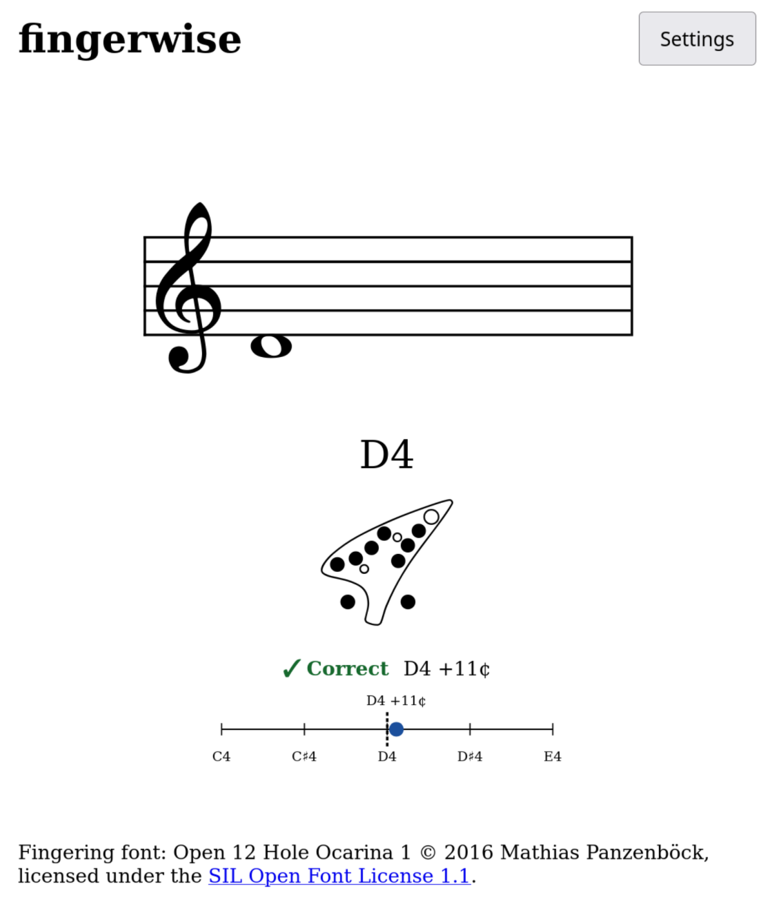

# fingerwise

A practice app for learning ocarina fingerings. It has three modes: **Flashcards** to learn the notes, **Song** to play a whole tune, and **Tuner** to see how in tune a note is. It listens through the microphone while you play your ocarina, and it plays tones so you can check by ear. It runs in the browser as an installable, offline-capable web app, and it is open source.

**Live site:** <https://mikeawilliams.github.io/fingerwise/>



The first target is the 12-hole ocarina. The design keeps instruments, clefs and staff styles as swappable data and layers so other instruments can be added later.

## Modes

Settings open with the choice of mode.

- **Flashcards:** a random note is drawn on the staff. After a delay, or on a click or key press, the app reveals the note name and the fingering and plays the note so you can check by ear. With judging on, it listens before the reveal and grades the note you played within a tolerance you set, with a graph of your pitch against the expected one. It judges pitch, not fingering. Notes you miss come up more often, and a missed card can stay until you play it right.
- **Song:** paste a tune in ABC notation, or load an ABC file (a whole tune book works; tunes the app cannot read are skipped). The tune is drawn as sheet music and you play it on your ocarina. Practise note by note with no clock, waiting on each note until you play it right, or play in time at the tune's tempo (or one you choose) and get a scored result: how much of each note was right, when it started and stopped, and an analysis of what to work on. Play song lets you hear the tune first.
- **Tuner:** play any note and the app shows which note it heard, with its name and fingering, and how many cents sharp or flat it is.

Other instruments and clefs is a parked idea. See [`docs/features/`](docs/features/) for the list.

## Documentation

| Where                                      | What it is                                                                                       |
| ------------------------------------------ | ------------------------------------------------------------------------------------------------ |
| [`docs/architecture/`](docs/architecture/) | What is actually built: overview, module docs, data formats, and decision records (ADRs).        |
| [`docs/features/`](docs/features/)         | One folder per feature: a design doc plus its stories with acceptance criteria. The plan, not fact. |
| [`docs/research/`](docs/research/)         | Background research: prior art, fingering data sources, licensing.                               |
| [`docs/templates/`](docs/templates/)       | Templates for features, stories, ADRs and progress files.                                        |
| [`docs/glossary.md`](docs/glossary.md)     | Domain terms.                                                                                    |
| [`story-progress/`](story-progress/)       | A checklist per feature currently being built. Deleted when the feature is accepted.                 |
| [`data/instruments/`](data/instruments/)   | Instrument definitions as JSON files.                                                            |
| [`data/fonts/`](data/fonts/)               | The bundled tablature font and its OFL license.                                                  |
| [`CLAUDE.md`](CLAUDE.md)                   | Working rules for Claude, which writes most of the code.                                         |

Feature designs are proposals, not promises: they record intent and may change, and only the architecture docs describe what is built.

The flow is: feature designs and stories, then progress tracking and code, then architecture docs updated to describe what was built. See [`docs/README.md`](docs/README.md) for the details.

## Building

The app runs entirely in the browser. The tools below are only needed to develop and build it; the built result is static files that any web host can serve.

### Prerequisites

| Tool                    | Role                                       | Install                     |
| ----------------------- | ------------------------------------------ | --------------------------- |
| git                     | Version control                            | Already present on Bazzite. |
| [Bun](https://bun.com/) | Runtime, package manager and script runner | `brew install bun`          |

Everything else is installed per project by `bun install`, so there is no global install for them:

| Tool                            | Role                              |
| ------------------------------- | --------------------------------- |
| [Preact](https://preactjs.com/) | UI library                        |
| TypeScript                      | Language and type checking        |
| [Vite](https://vite.dev/)       | Dev server and production bundler |
| [Vitest](https://vitest.dev/)   | Test runner                       |
| [Biome](https://biomejs.dev/)   | Linting and formatting            |

Check the install with `bun --version`. `make` is also used and is present on Bazzite.

### Commands

The `Makefile` is the entry point; each target wraps a `bun run` script from `package.json`. Run `make` to list them.

```bash
make install     # install dependencies from the lockfile
make dev         # dev server with hot reload (http://localhost:5173/fingerwise/)
make test        # run tests once
make test-watch  # run tests in watch mode
make check       # lint and format check (Biome)
make fix         # apply Biome fixes and formatting
make typecheck   # type-check (Vite does not type-check)
make build       # production build into dist/
make preview     # serve dist/ locally
make verify      # check + typecheck + test + build: must pass before a commit
make clean       # remove dist/ and coverage/
```

Vite is run through Bun here, and application code in `src/` runs in the browser, so it must not use Bun-specific APIs.

### Source layout

```
src/core/     pure logic: pitch, instrument, drill (no framework or browser imports)
src/render/   staff and tablature rendering
src/audio/    synth and pitch detection
src/app/      Preact UI and entry point (main.tsx)
tests/        Vitest tests
data/         instrument definitions (JSON) and the tablature font
```

## Run it locally

```bash
bun install      # or: make install
make dev         # http://localhost:5173/fingerwise/
make verify      # lint, type-check, tests and build
```

See [Building](#building) for the full command list.

## Contributing

Contributions are welcome, especially bug fixes, fingering corrections and new instruments. Read [`CONTRIBUTING.md`](CONTRIBUTING.md) first. This project is built with AI assistance; the details are there.

## License

MIT, see [`LICENSE`](LICENSE). Dependencies such as VexFlow and abcjs are MIT, and panzi's tablature fonts are unrestricted (the pitch detector is our own, [ADR 0005](docs/architecture/decisions/0005-yin-pitch-detector.md)). Fingerings must never be copied from commercial charts (Songbird, STL Ocarina and similar); use open sources and the open fonts. Code license and third-party asset notes stay separate in the repo.
