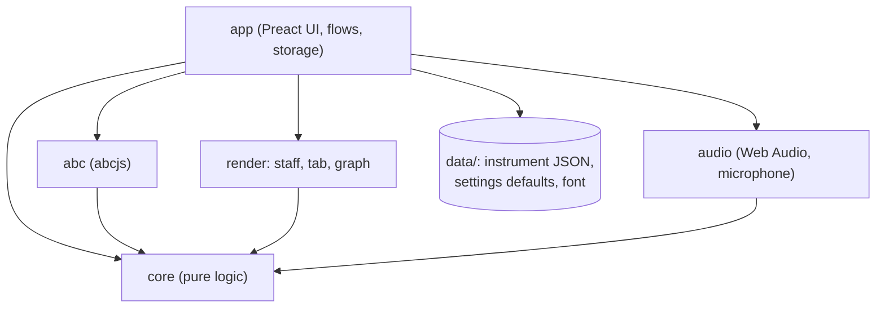
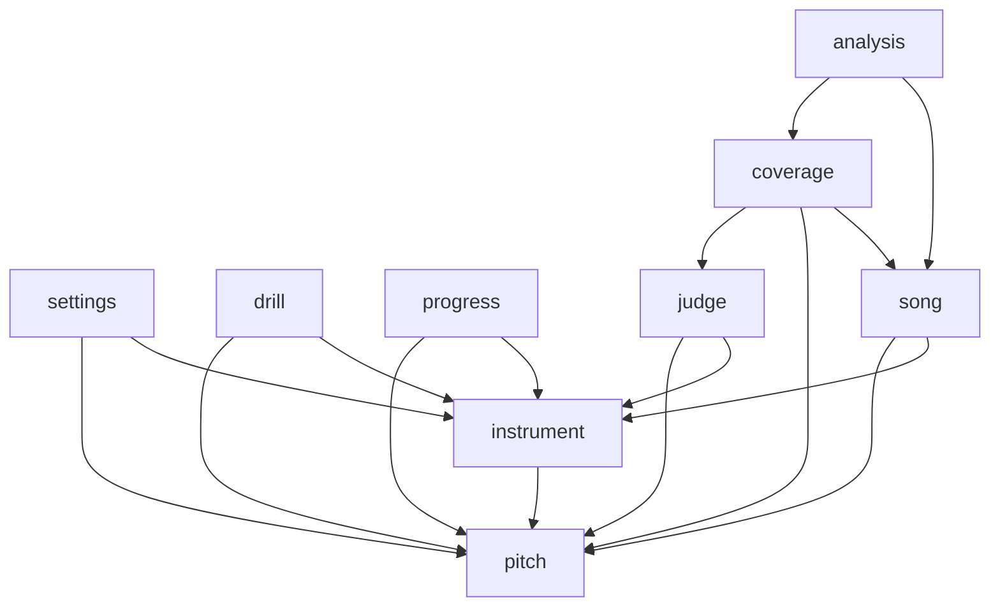
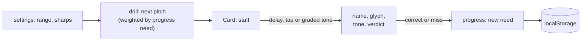
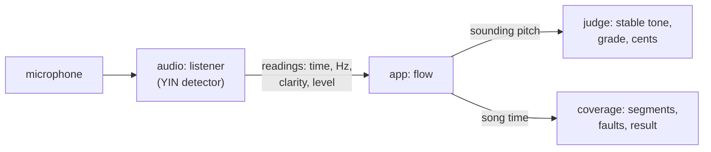

# Overview

How fingerwise is put together: the layers, what each may import, and how data moves through them. Details live in the [module docs](modules/); this page only connects them.

fingerwise is a static single-page app. Everything runs in the browser: there is no server, no account and no network call after the page and its assets load. It installs as a PWA and works offline ([ADR 0004](decisions/0004-pwa-with-vite-plugin-pwa.md), [deployment](deployment.md)). The stack is Bun, Vite, Preact, Vitest and Biome ([ADR 0001](decisions/0001-toolchain-and-ui.md)).

## Layers

| Layer | Folder | Holds | May import |
| --- | --- | --- | --- |
| Core | `src/core/` | Pure domain logic: [pitch](modules/pitch.md), [instrument](modules/instrument.md), [settings](modules/settings.md), [drill](modules/drill.md), [progress](modules/progress.md), [judge](modules/judge.md), [song](modules/song.md), [coverage](modules/coverage.md), [analysis](modules/analysis.md). | Other core modules only. No library, framework or browser API. |
| ABC adapter | `src/abc/` | [abc](modules/abc.md): ABC text to a `Song`, or a list of problems. | Core, and `abcjs` (loaded lazily). |
| Render | `src/render/` | Geometry and drawing: [staff](modules/staff.md) (VexFlow), [tab](modules/tab.md) (fingering glyphs), [graph](modules/graph.md) (pitch graph). | Core (`staff` also VexFlow). Never `src/app/`. |
| Audio | `src/audio/` | [audio](modules/audio.md): the one Web Audio context, tones, metronome clicks, the microphone listener and the YIN detector. | `src/core/pitch` only. |
| App | `src/app/` | [app](modules/app.md): Preact components, the mode flows, timers, storage, the font and the service worker. | Everything above, Preact, and the JSON and font files in `data/`. |

Arrows point from importer to imported. Nothing points back up: core imports no other layer, and render, audio and abc never import the app.

### Inside core

`pitch` has no import at all. The drill, progress, judge and song modules do not import each other; the app joins them (for example, it passes progress's `drawWeight` into the drill as a weight function).

## Rules and how they are checked

- **The layer rule.** The drill engine knows only pitch and instrument definitions, never clef, staff, audio or UI ([drill](modules/drill.md)).
- **Core is pure.** No framework, browser API, clock, timer or global randomness. Time arrives as a field on each reading or as an argument; randomness is an injected function. This keeps core deterministic under test.
- **Instruments are data.** An instrument is a JSON file in `data/instruments/` ([data formats](data-formats.md#instrument-json)), validated by [instrument](modules/instrument.md). Code never names a hole or a fingering.
- **`src/` uses no Bun-specific API**, since it runs in the browser.

Tests enforce the import rules by reading the sources:

| Test | Checks |
| --- | --- |
| `tests/core/core-imports.test.ts` | Core imports only relative paths, uses no browser globals, and `pitch` imports nothing. |
| `tests/extensibility/drill-layers.test.ts` | No drill file reaches clef, staff, render, VexFlow, Preact or the app, even through another core file. |
| `tests/audio/audio-imports.test.ts` | Audio imports only `core/pitch`; core does not import audio. |
| `tests/render/staff-imports.test.ts` | Staff and tab do not import the app; core does not import render. |

## Pitch

`Pitch` ([pitch](modules/pitch.md)) is the single internal representation: a branded MIDI note number. Every layer converts to and from it; names, frequencies, staff positions and glyphs are derived.

Two kinds of pitch meet at the edges ([ADR 0003](decisions/0003-written-pitch-and-transposition.md)):

- **Written pitch** is what the staff shows and what the fingering table, settings, songs, drill and stored progress use.
- **Sounding pitch** is what the ocarina produces: written plus the instrument's `transposition` (`soundingPitch` in [instrument](modules/instrument.md)). Tones, the judge and coverage work in sounding pitch.

The app converts at the boundary: written to sounding before playing a tone or grading, and sounding back to written before showing a heard note.

## Startup

1. `main.tsx` renders `App` and registers the service worker.
2. `App` imports the instrument JSON and `data/settings/defaults.json` at build time and validates them ([instrument](modules/instrument.md), [settings](modules/settings.md)).
3. Stored settings are read from `localStorage` and run through `validateSettings`, so each bad field falls back to its default and loading never throws ([data formats](data-formats.md#storage)). Smart sampling's scores are read the same way from their own key.
4. If a song text is stored, it is parsed through [abc](modules/abc.md) into one `Song` per tune (abcjs loads on first use).
5. The tablature font starts loading; [tab](modules/tab.md) shows a placeholder until it is ready.
6. One effect creates the **flow** for the current mode (below). Changing settings, opening the Settings view or hiding the page stops the flow and builds a new one, which also releases the microphone.

## Modes and flows

A flow is a plain TypeScript object in `src/app/` with `start`, `step` and `stop`, which owns timers and calls back with a new state. Components only render that state. Flows take their clock, timers, tone player and listener as parameters, so they are tested with fakes ([ADR 0012](decisions/0012-two-practice-modes.md), [ADR 0014](decisions/0014-tuner-mode.md)).

| Mode | Flow | Core used | Output |
| --- | --- | --- | --- |
| Flashcards | `card-flow.ts` | drill, progress, judge | A card per pitch: staff, then name, glyph, tone and verdict. |
| Song, Single note | `single-note-flow.ts` | song, judge | One note of the tune at a time, waiting until it is played right. |
| Song, Tempo | `timed-flow.ts` | song, coverage, analysis | The tune in time with a count-in, live or after-song scoring, then a summary and analysis. |
| Song, Play song | `playback-flow.ts` | song | The tune played as tones with a moving playhead. |
| Tuner | `tuner-flow.ts` | judge | Whatever note is heard, with its name, glyph and cents. |

### Flashcards

The pitch pool comes from the settings. With smart sampling on, [drill](modules/drill.md) draws by need from [progress](modules/progress.md) ([ADR 0007](decisions/0007-smart-sampling-by-need.md)). With judging on, the flow listens before the reveal and [judge](modules/judge.md) grades the first stable tone.

### Song

The ABC text becomes a `Song` ([song](modules/song.md)) of written pitches with start and length in beats, tempo and meter ([ADR 0006](decisions/0006-abcjs-for-songs.md), [ADR 0008](decisions/0008-songs-keep-rhythm.md)). A text may hold several tunes, and tunes that fail are kept as dropped tunes ([ADR 0010](decisions/0010-several-tunes-in-one-text.md), [ADR 0013](decisions/0013-dropped-tunes-from-a-file.md)). [staff](modules/staff.md) lays the song out in lines of bars.

In Tempo practice, the timed flow keeps time on the audio context's clock, not on timers, and places each microphone reading on the song's timeline in ms. [coverage](modules/coverage.md) classifies each reading against the note or rest due and builds segments, timing faults and the result ([ADR 0009](decisions/0009-timed-songs-scored-by-coverage.md), [ADR 0011](decisions/0011-release-allowance.md)). After the song, [analysis](modules/analysis.md) turns the finished run into a breakdown, habits and practice spots.

### Listening

All listening modes share one pipeline:

The listener runs the hand-written YIN detector ([ADR 0005](decisions/0005-yin-pitch-detector.md)) once per animation frame and emits plain readings. It knows nothing of notes or grades. Judge and coverage take the readings and thresholds as parameters and keep no clock of their own. Audio needs a user gesture to unlock; until then the flows show a prompt and retry on the next tap.

## State and storage

| What | Where | Key |
| --- | --- | --- |
| Settings, including the song's ABC text | `localStorage` | `fingerwise.settings` |
| Smart sampling scores, per instrument name | `localStorage` | `fingerwise.progress` |
| A song run's readings, segments and analysis | Memory only | |
| App files, for offline use | Service worker cache | |

Both stored values are validated on load and fall back to defaults; a missing or blocked `localStorage` gives defaults. Formats are in [data formats](data-formats.md#storage).

## Build and deploy

`make verify` runs Biome, the type-check, Vitest and the Vite build. CI runs the same checks on every push; a push to `main` also publishes `dist/` to GitHub Pages. A new build's service worker waits and takes over silently once the old version's windows are closed ([deployment](deployment.md)).
